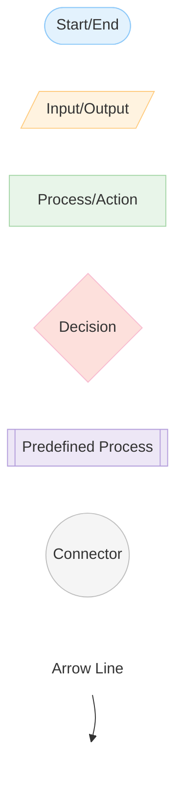
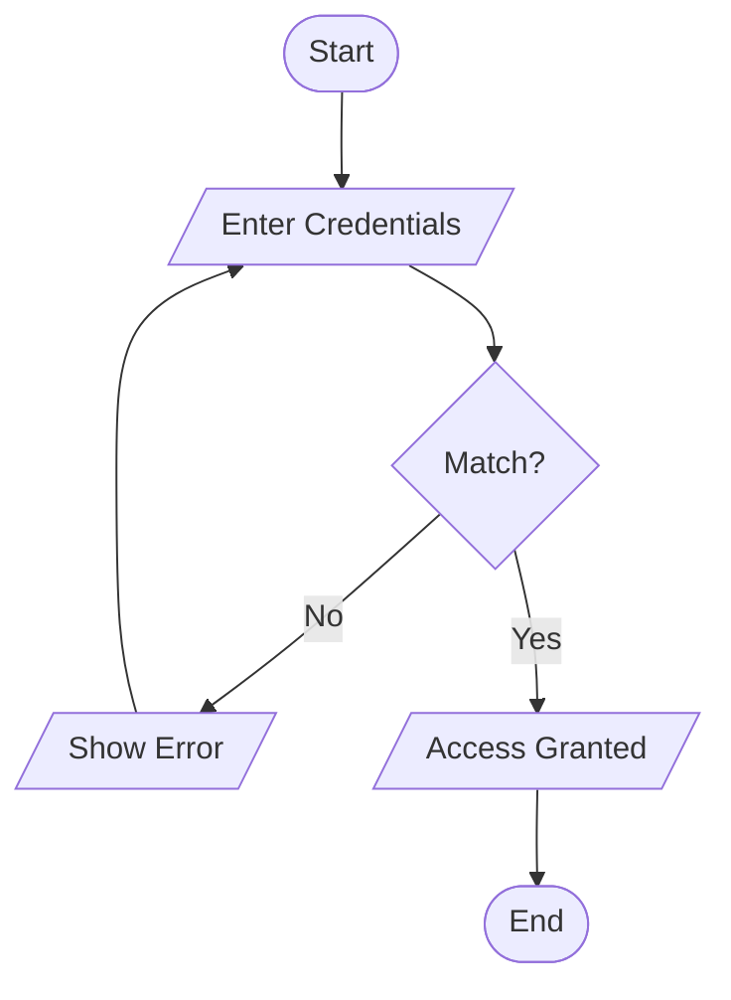

# Markdown Complete Reference Guide

## Table of Contents
1. [Headings](#headings)
2. [Text Formatting](#text-formatting)
3. [Lists](#lists)
4. [Links and Images](#links-and-images)
5. [Code](#code)
6. [Blockquotes](#blockquotes)
7. [Horizontal Rules](#horizontal-rules)
8. [Tables](#tables)
9. [Task Lists](#task-lists)
10. [Inline HTML](#inline-html)
11. [Flow Chart](#Flow-Chart)
12. [Special Elements](#special-elements)

---

## Headings

# Heading Level 1 (H1)
## Heading Level 2 (H2)
### Heading Level 3 (H3)
#### Heading Level 4 (H4)
##### Heading Level 5 (H5)
###### Heading Level 6 (H6)

---

## Text Formatting

### Basic Text Styles

This is **bold text** using double asterisks or double underscores like __this__.

This is *italic text* using single asterisks or single underscores like _this_.

This is ***bold and italic text*** using triple asterisks or triple underscores like ___this___.

This is ~~strikethrough text~~ using double tildes.

This is `inline code` using backticks.

This is a <u>underlined text</u> using HTML tags.

This is <mark>highlighted text</mark> using HTML mark tags.

This is <sub>subscript text</sub> and this is <sup>superscript text</sup>.

### Text with Line Breaks

This is line one.  
This is line two (note the two spaces at the end of the previous line).

This is line three.

---

## Lists

### Unordered Lists

Simple unordered list:
- Item 1
- Item 2
- Item 3

Alternative syntax with asterisks:
* Item A
* Item B
* Item C

Alternative syntax with plus signs:
+ Item X
+ Item Y
+ Item Z

### Ordered Lists

Simple ordered list:
1. First item
2. Second item
3. Third item

Ordered list with different starting number:
5. Fifth item
6. Sixth item
7. Seventh item

### Nested Lists

Main list:
1. First main item
   - Nested unordered item
   - Another nested item
     * Double nested item
     * Another double nested
2. Second main item
   1. Nested ordered item
   2. Another nested ordered item
3. Third main item

Mixed nesting:
- Item 1
  - Subitem 1.1
    1. Ordered subitem
    2. Another ordered subitem
  - Subitem 1.2
- Item 2

---

## Links and Images

### Links

This is a [link with text](https://www.example.com).

This is a [link with title](https://www.example.com "Example Website").

This is a [reference link][1] that uses a reference definition.

This is an [automatic link](https://www.example.com) to a website.

[1]: https://www.example.com

### Image Links

Inline image:


Image as a link:
[](https://www.example.com)

Image with reference:
![Alt text][image-ref]

[image-ref]: https://via.placeholder.com/200x100

---

## Code

### Inline Code

Use the `console.log()` function to print messages.

Use `npm install` to install packages.

### Code Blocks (Fenced)

Plain code block:
```
This is a plain code block
without any syntax highlighting
```

JavaScript code block:
```javascript
function greet(name) {
    console.log(`Hello, ${name}!`);
}

greet("World");
```

Python code block:
```python
def greet(name):
    print(f"Hello, {name}!")

greet("World")
```

HTML code block:
```html
<div class="container">
    <p>Hello, World!</p>
</div>
```

CSS code block:
```css
.container {
    display: flex;
    justify-content: center;
    align-items: center;
}
```

JSON code block:
```json
{
    "name": "John Doe",
    "age": 30,
    "city": "New York"
}
```

Bash code block:
```bash
#!/bin/bash
echo "Hello, World!"
ls -la
cd /home
```

### Code Block with Line Numbers and Highlighting

```javascript {highlight: [2, 3]}
function example() {
    const x = 10;
    const y = 20;
    return x + y;
}
```

---

## Blockquotes

Simple blockquote:
> This is a simple blockquote.

Blockquote with multiple lines:
> This is the first line of the blockquote.
> This is the second line of the blockquote.
> This is the third line of the blockquote.

Blockquote with paragraphs:
> This is the first paragraph.
>
> This is the second paragraph.

Nested blockquotes:
> This is the first level blockquote.
>> This is a second level blockquote.
>>> This is a third level blockquote.

Blockquote with other elements:
> **Bold text** in blockquote
> 
> - List item 1
> - List item 2
>
> `Code` in blockquote

---

## Horizontal Rules

Three or more hyphens:
---

Three or more asterisks:
***

Three or more underscores:
___

---

## Tables

### Basic Table

| Column 1 | Column 2 | Column 3 |
|----------|----------|----------|
| Cell 1   | Cell 2   | Cell 3   |
| Cell 4   | Cell 5   | Cell 6   |

### Table with Alignment

| Left Aligned | Center Aligned | Right Aligned |
|:-------------|:--------------:|---------------:|
| Content 1    | Content 2      | Content 3     |
| Content 4    | Content 5      | Content 6     |

### Complex Table

| Feature | Description | Status |
|---------|-------------|--------|
| **Bold Header** | Description with `code` | ✓ Active |
| *Italic Text* | Another [link](https://example.com) | ✗ Inactive |
| Regular | Table with  | ⚠ Pending |

---

## Task Lists

- [x] Completed task
- [ ] Incomplete task
- [x] Another completed task
- [ ] Work in progress task
- [ ] Future task

### Task List with Nesting

- [x] Main task completed
  - [x] Subtask 1
  - [ ] Subtask 2
  - [x] Subtask 3
- [ ] Main task incomplete
  - [x] Subtask 1
  - [ ] Subtask 2

---

## Inline HTML

You can use inline HTML elements:

This is a <span style="color: red;">red text</span> using span.

<div style="background-color: lightblue; padding: 10px;">
This is a div element with styling.
</div>

---

## Flow-Chart




---

## Special Elements

### Escaping Characters

Use backslash to escape special characters:

\*This is not italic\*

\[This is not a link\]

\# This is not a heading

### Horizontal Line (Alternative)

Use three or more dashes, asterisks, or underscores:

---

### Line Break Within List

List item one

Paragraph within list item

Another paragraph within list item

### Abbreviations

The HTML specification is maintained by the W3C.

*[HTML]: HyperText Markup Language
*[W3C]: World Wide Web Consortium

### Footnotes

This is a simple footnote[^1]. This is another footnote[^2].

[^1]: This is the content of the first footnote.
[^2]: This is the content of the second footnote. It can have multiple lines and even contain [links](https://example.com).

### Description Lists

Term 1
:   Definition of term 1

Term 2
:   Definition of term 2
:   Another definition of term 2

### Superscript and Subscript

E=mc<sup>2</sup>

H<sub>2</sub>O

### Keyboard Input

Press <kbd>Ctrl</kbd> + <kbd>C</kbd> to copy.

Press <kbd>Shift</kbd> + <kbd>Alt</kbd> + <kbd>T</kbd> to open terminal.

### Definition/Variable

The <var>x</var> variable is defined as <code>x = 5</code>.

### Small Text

This is <small>smaller text</small> compared to normal text.

### Code with Syntax Highlighting

```javascript
const greeting = "Hello, World!";
console.log(greeting);

function add(a, b) {
    return a + b;
}
```

### Comments


<!-- This is a comment and won't be displayed -->

<!-- 
This is a multi-line comment
that spans multiple lines
and won't be rendered
-->
--- 

### Mathematical Expressions (LaTeX)

Inline math: $E = mc^2$

Display math:
$$
\frac{-b \pm \sqrt{b^2 - 4ac}}{2a}
$$

Quadratic formula:
$$
x = \frac{-b \pm \sqrt{b^2 - 4ac}}{2a}
$$

---

### Emoji

#### Emotions & Faces
😀 😃 😄 😁 😆 😅 🤣 😂  
❤️ 🧡 💛 💚 💙 💜  

#### Programming & Development
🚀 ✨ 💻 🖥️ ⌨️ 🖱️ 💾 📁 📂 🔧 🔨 ⚙️ 🛠️  
🐍 🦀 🐹 🐸 
📝 📄 📋 📊 📈 📉  
🔍 🔎 🐛 ⚠️ ✅ ❌ ⛔ 🚫 🚨  
🔐 🔒 🔓 🗝️   
📦 📚 📖 📕 📗 📘 📙  
🌐 🌍 🌎 🌏  
⏱️ ⏰ ⏳ ⌛  
💡 🔦 💭 💬 🗨️  
🎯 🎪 🎨 🎬  

#### Version Control & Git
🔀 🔁 🔂 🔃   
📤 📥   
💾 📦  
🌳 🌲 🌴 🏷️   

#### Status & Progress
✅ ✔️ ☑️ ❌ ✖️  
⚠️ ⚡ 🔥⏳ ⌛🚀  
🔄 ♻️ ⏸️ ⏭️ 

#### Priority & Importance
🔴 🔵 🟢 🟡 🟠  
⭐ ⭐⭐⭐⭐  
🔝  
❗ ❓ ❔ ℹ️ 

#### Testing & Quality
✅ ❌ 🧪 🎯 🏆  

#### Collaboration & Teams
👥 👫 👬 👭  
🤝💬 📢 📣  
👨‍💻 👩‍💻 👔  

#### Other Useful
📌 📍🔗 📎 📧 📞 ✉️ 🎁 🗑️ ⚡ 🌟

---

## Summary

This markdown document covers:

✓ All heading levels (H1-H6)  
✓ Text formatting (bold, italic, strikethrough, etc.)  
✓ Ordered and unordered lists with nesting  
✓ Links and images with multiple syntax options  
✓ Inline code and code blocks with syntax highlighting  
✓ Blockquotes with nesting  
✓ Horizontal rules  
✓ Tables with alignment options  
✓ Task lists  
✓ Inline HTML elements  
✓ Special elements (escaping, footnotes, abbreviations, etc.)
